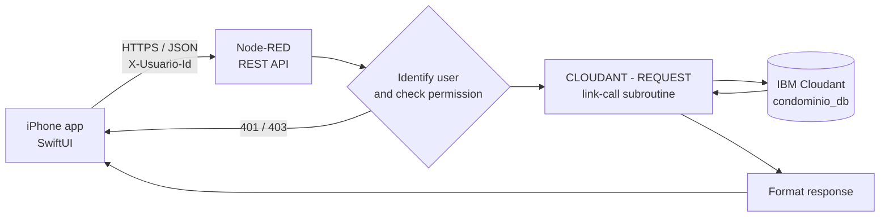
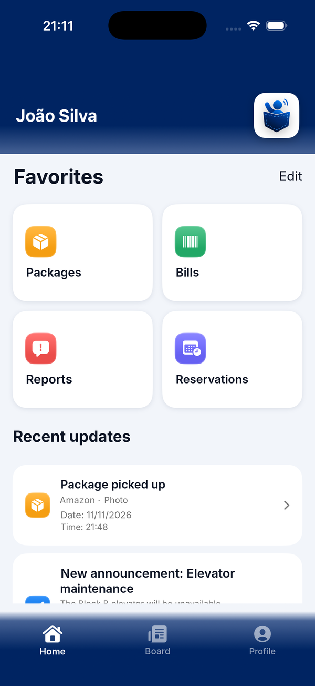
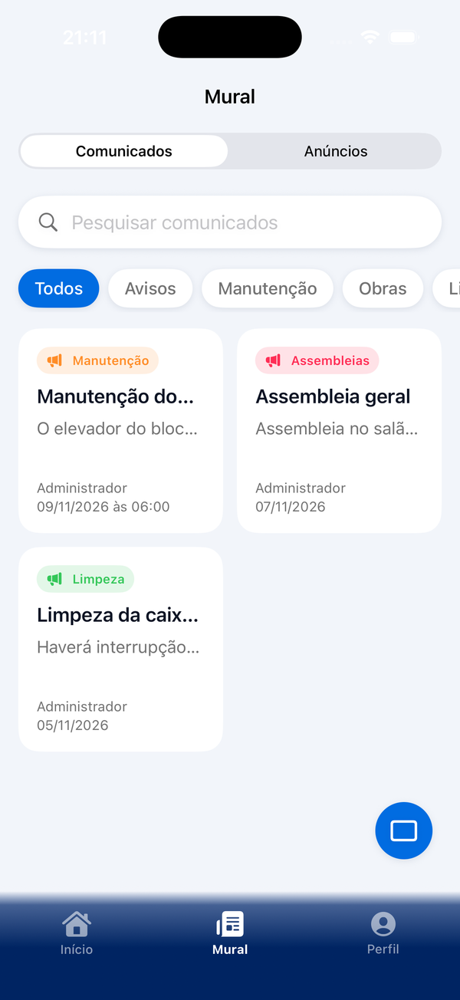
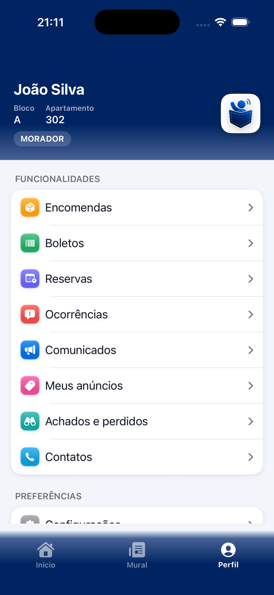

<p align="center">
  
</p>

<h1 align="center">PocketSindico</h1>

<p align="center">
  <b>One official channel between residents, the building manager and the front desk.</b>
</p>

<p align="center">
  
  
  
  
  
</p>

<p align="center">
  Final project of the <b>HackaTruck MakerSpace</b> (night shift), 2026.
</p>

---

## The problem

Managing vertical condominiums is hard, and communication between residents, the building manager (*síndico*) and the front desk is usually scattered across group chats, paper notices and phone calls. Two numbers from Brazilian condominium surveys shaped the project:

| Who | Finding | What it means for the app |
|---|---|---|
| **Building managers** | 36% name general complaints from residents as a main challenge | Complaints need a structured, trackable channel |
| **Residents** | 47% are dissatisfied with their building manager; the top complaint is that issues are never resolved | Residents need to see that their report was received and answered |

<sub>Sources: Censo SíndicoNet 2021 and Pesquisa Pró-Síndico.</sub>

PocketSindico answers with three pillars:

| Pillar | In the app |
|---|---|
| **Communication** | An official channel for announcements, a bulletin board and direct contacts |
| **Conflicts** | Incident reports sent straight to the building manager, with *Waiting* and *Received* status and a written reply |
| **Payments** | Bills with the open total, overdue bills highlighted and a barcode line ready to copy and pay |

> [!IMPORTANT]
> All people, units, bills and phone numbers in this repository are **fictional demo data**. The app ships with a demo mode that switches between three profiles.

## How it works



Every route follows the same pattern: **HTTP IN → identify user → authorize → query Cloudant → format → HTTP RESPONSE**. Permissions live on the server, so the app never decides on its own what a user may do.

### Roles

| Role | Who | Main actions |
|---|---|---|
| **Resident** (`morador`) | People who live in the building | Track packages, pay bills, book shared spaces, report incidents, post listings |
| **Guard** (`guarda`) | Front desk and security | Register packages and lost-and-found items, view reservations |
| **Building manager** (`sindico`) | The elected manager | Publish announcements, receive and answer reports, oversee bills and bookings, moderate the board |

### Features

| Feature | Resident | Guard | Building manager |
|---|:---:|:---:|:---:|
| **Packages**: list, search, filters, photo, pickup date | Own | Register, edit, status, unknown recipient | Same as guard |
| **Bills**: open, paid and overdue, copy barcode, share | Own | — | All |
| **Reservations**: barbecue area, party room, basketball court, soccer field, gym | Book and cancel | View | Book, view, cancel |
| **Incident reports**: *Waiting* / *Received* tabs, history, photo | Send | Send | Receive, reply, courtesy reminder |
| **Lost and found**: categories, status, photo | View | Register and edit | Register and edit |
| **Bulletin board**: announcements and listings with photos, likes and comments | ✓ | ✓ | ✓ and moderate |
| **Contacts**: call the building manager or the front desk | ✓ | ✓ | ✓ |
| **Home**: customizable favorites and the latest announcement and package | ✓ | ✓ | ✓ |

### Design decisions

| Decision | Why |
|---|---|
| **One Cloudant database** for every feature, split by a `tipo` field | Simpler setup, one set of credentials, shared indexes |
| **Deterministic reservation ids** (`reserva_<space>_<date>_<hour>`) | The database itself rejects a double booking with **409**, with no race conditions |
| **Report opened = report received** (`PUT /ocorrencias/:id/receber`) | The resident sees the status change the moment the manager opens it |
| **Packages with unknown recipient** | Labels without a name or unit still get registered and assigned later |
| **Photos as Base64 inside the document**, compressed by the app | No extra storage service; the server rejects documents over 1 MB with **413** |
| **Idempotent setup tab** in Node-RED | Creates the database, indexes and demo data on start without overwriting anything |

## Screenshots

<p align="center">
  
  
  
</p>

<p align="center"><sub>Home with favorites and recent updates · Bulletin board with announcements and listings · Profile with every feature</sub></p>

## Quick start

```bash
git clone <repository-url> pocketsindico
cd pocketsindico/backend
cp .env.example .env
docker compose up -d
```

1. Fill in `CLOUDANT_URL` and `CLOUDANT_API_KEY` in `backend/.env` (IBM Cloud → Cloudant → Service credentials).
2. Open http://localhost:1880 → menu ☰ → **Import** → `backend/node-red/flows/pocketsindico_flows.json` → **Deploy**. The **11 DATABASE SETUP** tab creates the database, the indexes and the demo data.
3. Open `ios/CondominioApp.xcodeproj` in **Xcode 26**, choose your team under *Signing & Capabilities* and run on an iOS 26.1 simulator.

<details>
<summary><b>Running on a physical iPhone</b></summary>

1. Connect the iPhone to the same Wi-Fi as the computer running Node-RED.
2. In the app, open **Perfil → Configurações** (Profile → Settings).
3. Type `http://YOUR-COMPUTER-IP:1880` in **Servidor (Node-RED)** and tap **Testar e recarregar** (Test and reload).
4. Allow **Local Network** access when iOS asks.

</details>

<details>
<summary><b>Running without a backend</b></summary>

Set `APIConfig.usarMock = true` in `ios/CondominioApp/Services/APIService.swift`. Every feature then runs on local demo data with the same rules as the server.

</details>

### Demo profiles

| Id | Name | Role | Unit |
|---|---|---|---|
| `DEMO-001` | João Silva | Resident | Block A · Apt 302 |
| `DEMO-002` | Carlos Souza | Guard | — |
| `DEMO-003` | José Berto | Building manager | — |

Switch profiles in the app under **Perfil → Trocar perfil**.

## API

42 endpoints across 15 Node-RED tabs. The full reference, with every route, status code and permission, is in [`backend/README.md`](backend/README.md).

| Area | Routes |
|---|---|
| Session and home | `/api/demo/perfis` · `/api/permissoes` · `/api/favoritos` · `/api/home` |
| Bulletin board | `/api/comunicados` · `/api/anuncios` · `/api/anuncios/:id/comentarios` |
| Packages | `/api/encomendas` · `/api/moradores` |
| Bills and contacts | `/api/boletos` · `/api/contatos` |
| Incident reports | `/api/ocorrencias` · `/receber` · `/responder` |
| Lost and found | `/api/achados` |
| Reservations | `/api/reservas` · `/api/reservas/minhas` |

The Postman collection in `backend/postman/` covers permissions, ownership rules and error codes (400, 401, 403, 404, 409) for every module.

## Repository structure

```
.
├── ios/
│   ├── CondominioApp.xcodeproj
│   └── CondominioApp/
│       ├── App/              Entry point, session, custom tab bar
│       ├── Components/       Header, cards, photo picker, filters
│       ├── Models/           Codable models for each feature
│       ├── Services/         API client, demo data, local reminders
│       ├── Utilities/        Theme and visual identity
│       └── Views/            Home, Mural, Perfil, Configurações and one folder per feature
├── backend/
│   ├── node-red/flows/       pocketsindico_flows.json
│   ├── cloudant/             Indexes, seed data, sample documents, load script
│   ├── postman/              API test collection and environment
│   ├── docker-compose.yml
│   └── .env.example
├── assets/logo/              App logo
└── docs/img/                 Screenshots
```

## Tools

| Tool | Used for |
|---|---|
| **Xcode** | Building the iOS app in Swift and SwiftUI |
| **Node-RED** | The server and REST API that connect the app to the database |
| **IBM Cloudant** | Cloud NoSQL database that stores and organizes all app data |
| **Postman** | Automated API tests |
| **Google Drive** | Where the team organized and shared project files |

## Progress

- [x] Unified app with packages, bills, reservations, incident reports, lost and found, bulletin board and contacts
- [x] Role-based permissions enforced on the server
- [x] Single Cloudant database with automatic setup
- [x] Postman collection for every module
- [x] Light, dark and system themes with a consistent visual identity

## Authors

**[Arthur Ilha Kirsch](https://github.com/arthurzxzx)**, **[Eduardo Militz da Silva](https://github.com/eduu1345)**, **[Evelyne Jean Louis](https://github.com/jeanlouisevelyne822-prog)**, **[Manoel Rodrigues Fonseca](https://github.com/ManoloFonseca)** and **Pietro Chiapinotto Drachler**, night shift team of the HackaTruck MakerSpace.
Built as the final project of the HackaTruck MakerSpace (Oct 13 – Nov 13, 2026).
